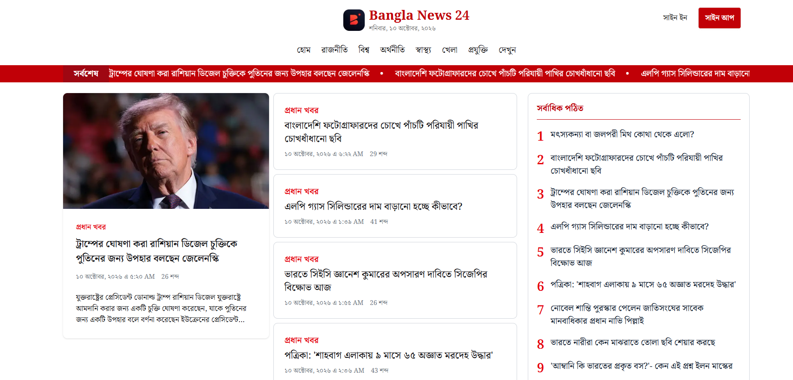
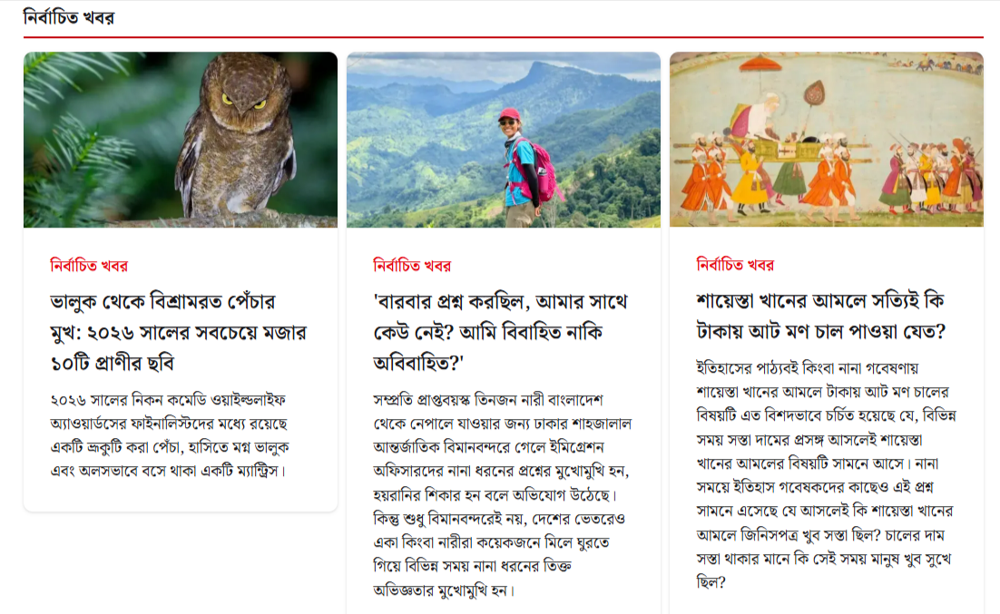
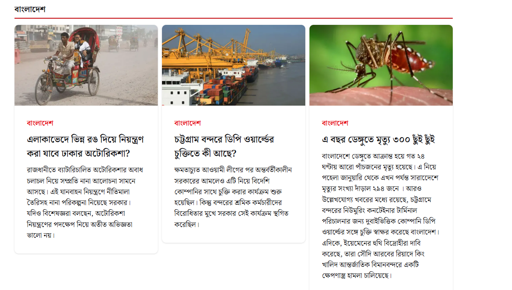
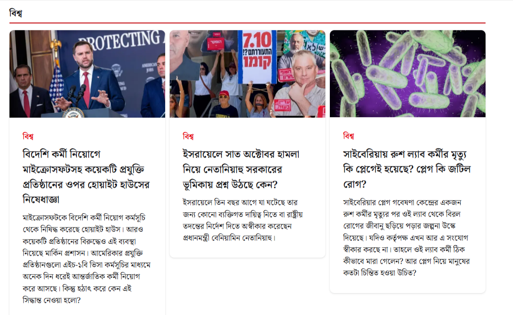
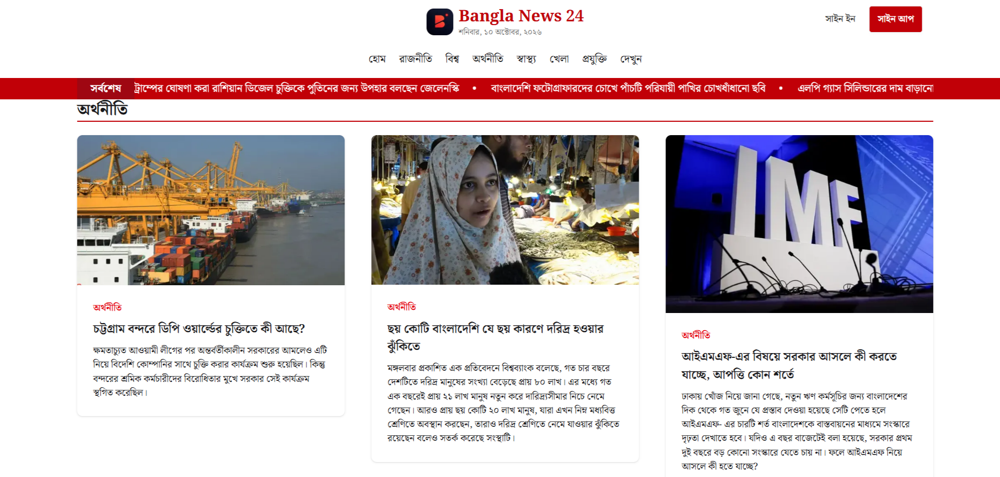
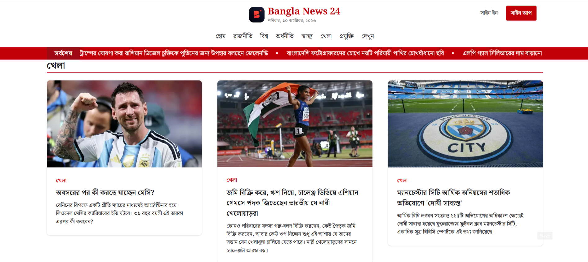
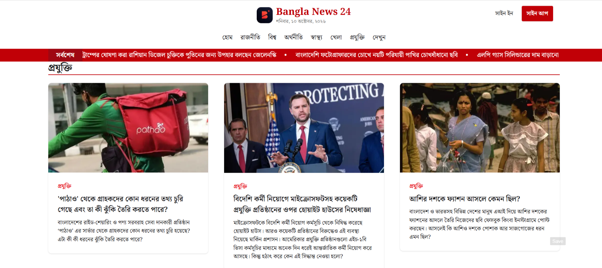
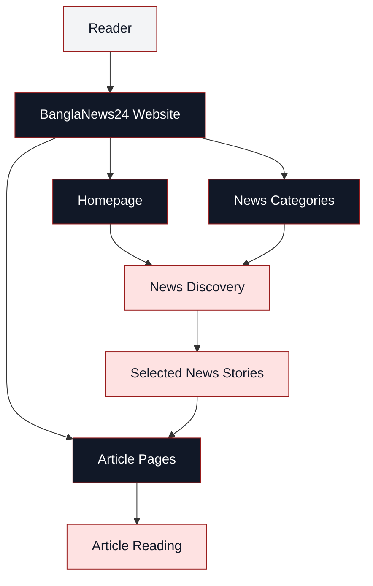

 

### Your Daily Window to Bangladesh and the World

  
  

  
  
  
  

**বাংলাদেশ ও বিশ্বের খবর, এক জায়গায়।**

A modern Bengali news platform designed to bring headlines, current affairs, and stories closer to readers through a clean digital reading experience.

---

## 📰 The Newsroom

**The homepage — your starting point for the latest news.**

BanglaNews24 is a Bengali-language news website focused on presenting news and current affairs in an accessible, organised, and reader-friendly format.

From developments in Bangladesh to international affairs, business, technology, sports, and more, the platform is designed around the way readers discover and consume news online.

**Visit the newsroom:** [bangla-news24-orcin.vercel.app](https://bangla-news24-orcin.vercel.app/)

---

## 🗞️ Inside the Newsroom

<table>
<tr>
<td width="50%" valign="top">

### Latest Headlines

Explore recent stories and follow developing events.

</td>
<td width="50%" valign="top">

### Bangladesh

Discover national developments, public affairs, and local news.

</td>
</tr>
<tr>
<td width="50%" valign="top">

### World Affairs

Follow international events and global developments.

</td>
<td width="50%" valign="top">

### Business & Economy

Explore business news, economic developments, and market stories.

</td>
</tr>
<tr>
<td width="50%" valign="top">

### Sports

Follow sporting events, competitions, and results.

</td>
<td width="50%" valign="top">

### Technology

Discover technology developments and the digital world.

</td>
</tr>
</table>

---

## ✦ Editorial Features

| Feature | Description |
|:---|:---|
| 📰 News Homepage | A central destination for discovering stories |
| 🗂️ News Categories | Topic-based news discovery |
| 🔥 Featured Stories | Highlighted headlines and important coverage |
| 📱 Responsive Reading | An interface designed for different screen sizes |
| 🔐 User Authentication | Access to supported account features, if implemented |
| ⚡ Modern Web Experience | A contemporary frontend application |

---

## 🏗️ How the Application Fits Together

*This is a conceptual content-navigation diagram, not a claim about the site's internal backend implementation.*

---

## 🛠️ Technology & Engineering

### Application Framework

### Styling

### Development & Deployment

---

## 👨‍💻 About the Developer

### Abdulla Sahed

Developer of BanglaNews24

---

# Bangla News 24

### খবরের সাথে থাকুন, বিশ্বের সাথে থাকুন।

**BanglaNews24 — Stories that matter.**

 

  

Built with ❤️ by Abdulla Sahed

